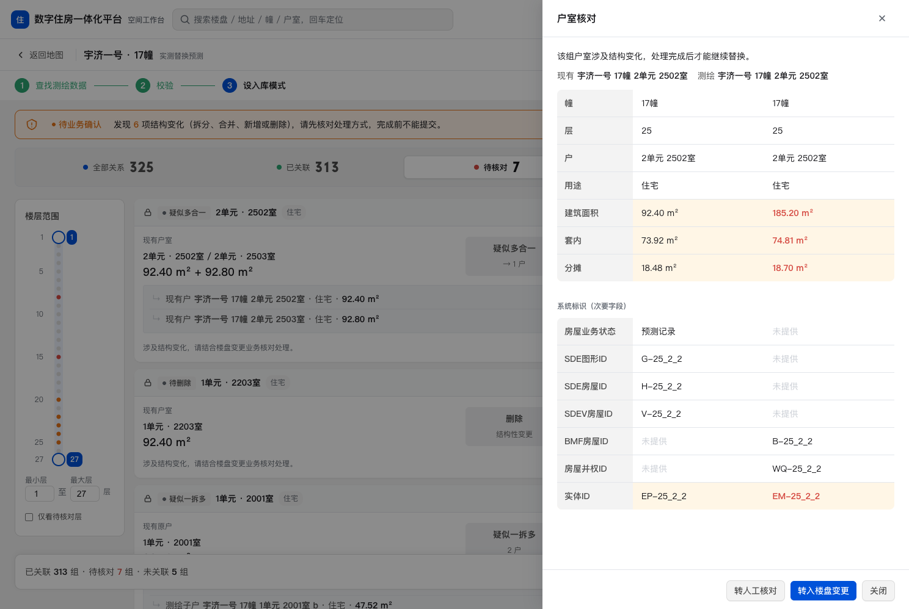
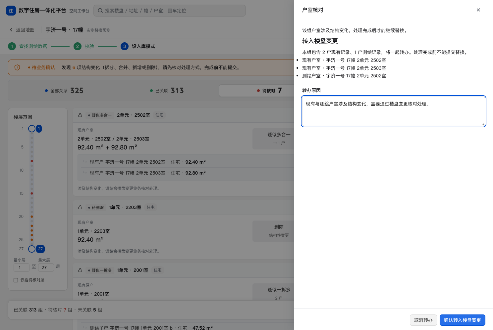

# GIS 任务原型样式与功能交接

本轮工作分两阶段。10 月 15 日按用户批注调整字号、字重、卡片分组和间距，要求保留全部内容与操作。10 月 16 日用户指出转办按钮缺失，经历史记录确认，恢复此前已确认但未合入主分支的功能。当前版本同时保留两阶段的结果。

## 已采纳的样式

| 区域 | 当前安排 | 解决的问题 |
| --- | --- | --- |
| 关系卡 | 两侧分别纵向排列来源、户室和面积，中间保留差异；两侧内容左对齐 | 同一户室的标签、名称和面积靠在一起，减少来回寻找 |
| 字阶 | 户室名称 14px / 500，面积 18px / 500，卡片标题 14px / 600；统计数 24px / 600 | 保留面积与状态层级，减少整卡同时加粗的竞争 |
| 楼层范围 | 轨道高度 364px，标题到轨道 24px，轨道到输入区 28px；低高度窗口允许侧栏随内容滚动 | 避免刻度和范围输入挤在一起 |
| 筛选工具栏 | 使用现有中性灰变量，选中项仍为白色 | 与白色关系卡形成区域区分 |
| 核对抽屉 | 字段标签宽 124px、字重 500；按钮高 32px、字号 14px | 字段和底部操作更容易扫读 |

10 月 15 日样式阶段逐字比对了全部 `style` 标签以外的源码，页面文字、数据、HTML 与脚本均未改变。浏览器比较了四种筛选下卡片与表格的文字，结果一致；1280px、1352px、1592px 下检查了对比区域溢出。该比较只证明样式调整没有改动当时的功能，不能证明当时的功能已包含此前所有已确认修改。

[样式阶段截图](style-only-2026-10-15.png)保留当时页面，尚未恢复转办功能，不能用它判断当前按钮或提示文字。

## 已恢复的功能

恢复源为 `codex/portfolio-design-evidence` 的 `90ee622`，以共同祖先 `8e71f58` 合并当前样式。当前任务页非样式内容与该历史功能版本一致。恢复了转人工、楼盘变更、整组对象确认、原因校验、待处理标记与撤回；校验有警示时允许继续核对，但仍限制提交。详细原因见[功能恢复记录](../../history/gis-workflow-recovery-2026-10-16.md)。

以上两张图于 10 月 16 日从本地可操作原型截取，视口为 1488×998。均为维护取证，使用合成数据，不代表实际转办或入库结果。

## 下次接手

当前源码只在 `public/projects/real-estate-gis/prototypes/task/index.html`，依赖同目录上一级的 `prototype-note.css`。案例页的 iframe 与新窗口链接由 `PrototypeFrame.astro` 的同一个 `src` 生成。两个页面加载相同功能，各自的临时转办状态独立，刷新会清除。

样式调整继续保留文字、数据、按钮和交互。检查内容差异前，先核对 `step`、`view`、`filter` 等参数；“全部关系”首项为 2701 室，“待核对”首项为 2502 室。若功能退回，查全部分支及配套测试，不以当前备份或旧截图替代历史依据。

三组任务原型测试分别覆盖转办流程、校验流程和内嵌／新窗口一致性，文件为 `tests/gis-routing.spec.ts`、`tests/gis-validation.spec.ts`、`tests/gis-prototype-parity.spec.ts`。整站验证结果见[本次交付记录](../../history/git-delivery-2026-10-16.md)。

案例窄屏仍使用旧静态海报 `13-task-relations-focus.png`，它没有包含此次样式和转办功能；后续更新海报时须重新从当前入口取图，并同步素材索引。可操作原型的验收以运行页面为准。
