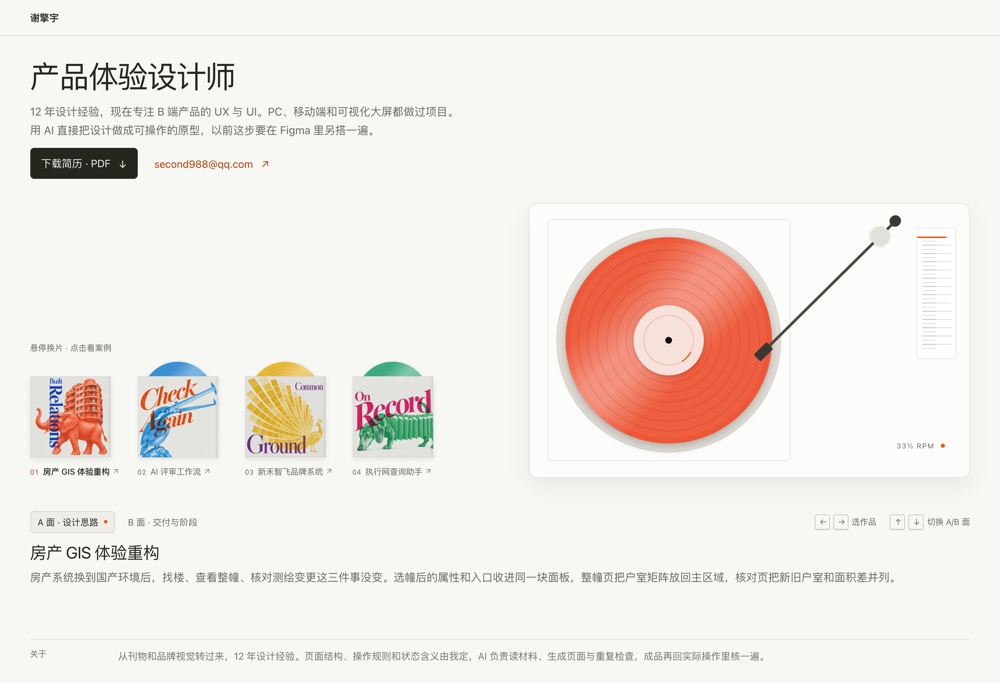
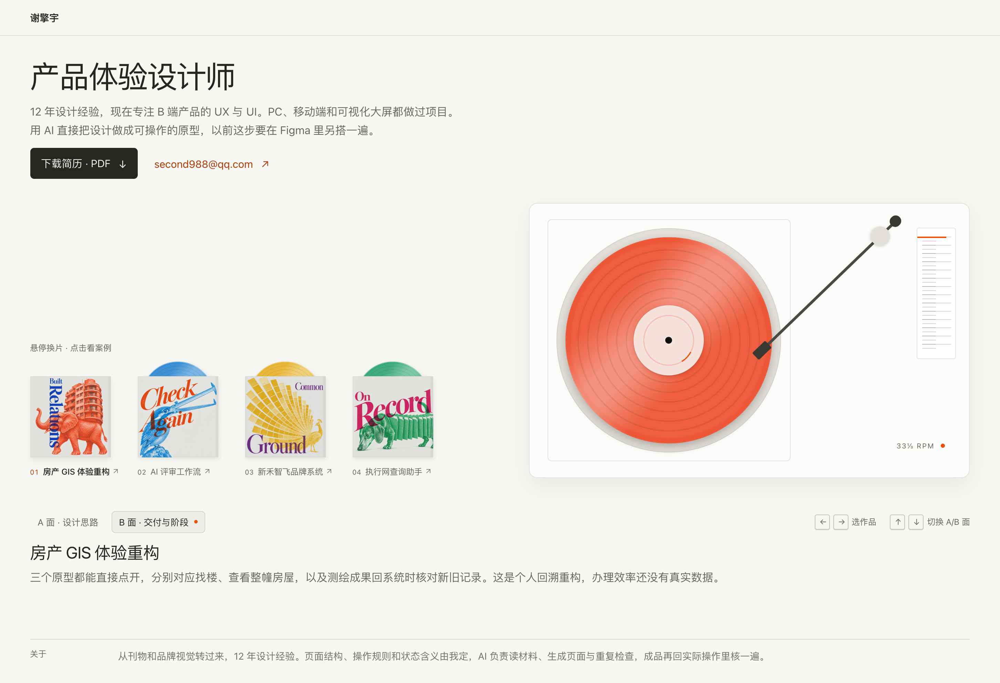
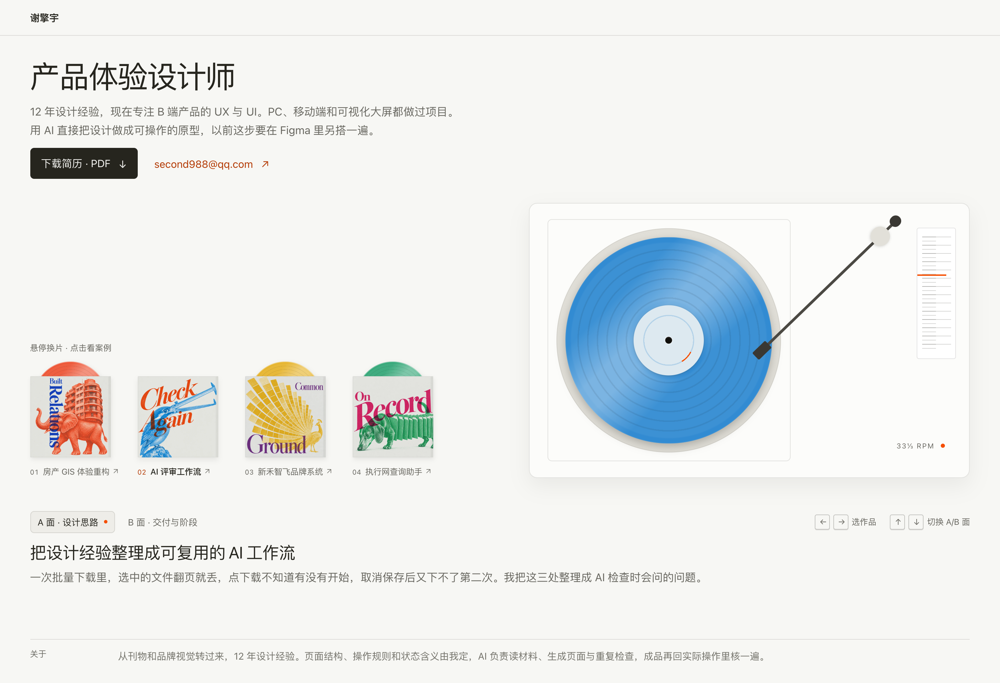
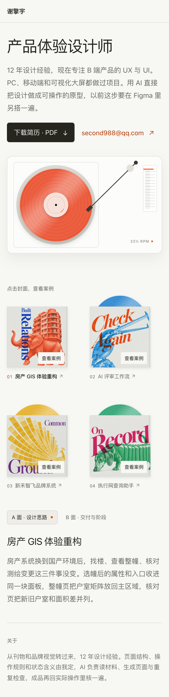

# 首页按改写指标改写（草稿）

2026-10-19。目标文件 `src/pages/index.astro`。**本轮只出草稿，源码与构建产物都没有改动**：下面的截图和高度数据，是在已构建的 `dist/` 上于浏览器运行时替换文本得到的，刷新即还原。

配套阅读地图是同目录的 `mindmap.html`，双击用浏览器打开即可。左栏是结构导图，点节点跳到对应结论，`←` 返回上一处，`↓ ↑` 在节点间移动，`/` 搜节点；开「只看结论」会收起原稿与未采用写法，只留判断、要点和改后的文本。

## 依据与范围

- 依据：`PRODUCT.md` 第 90–116 行的「改写验收指标」（九项）与「案例叙述原则」；`AGENTS.md` 的公开文案规则；四篇案例改写稿的处理方式。
- 涉及 14 条面向读者的文本，其中 10 条有改动：首屏导语、八个 A/B 面、关于。
- 未改：页面 `title`、`description`、`h1`、四条作品标题、封套短标题与 aria-label、操作提示（悬停换片／点击封面）、A/B 面按钮文字、关于的标题、结构、组件、样式与交互脚本。
- 草稿形成时没有按当前项目要求完成 `$human-writing` 复核。页面文案正式回填前，还要完成现实题材核验、修订复核和配套文本扫描。

## 先量版面，再定字数

首页不是可自由加长的文章页。`tests/turntable.spec.mjs:223` 要求 1452×993 时 `.about` 底边不超过 993，当前实现是 **979**，只剩 14px 余量；导语每多一行是 27.2px，任一 A/B 面多一行也是 27.2px（`.work__faces` 高度取两面中较高者，隐藏面用 `visibility: hidden` 仍占位）。也就是说，多写两句话就会把首屏契约打穿，而且失败原因看起来像布局问题，实际是文案长度。

实测（构建产物 + 本机 Chrome，替换文本后测量）：

| 版本 | 导语 | 每面 | `.about` 底 / 993 | 文档高 | 结论 |
| --- | --- | --- | --- | --- | --- |
| 现状 | 2 行 | 1 行 | 979 | 993 | 基准 |
| **A 紧凑版（主推）** | 2 行 | 1 行 | 979 | 993 | 行数守恒，回填后现有测试可原样通过 |
| B 完整版（备选） | 3 行 | 2 行 | 1007 | 1007 | 超 14px，须先放宽契约或压缩版面 |

其他视口（A 版）：1440×810 文档 952、`.about` 底 952（与现状相同）；1920×1080 文档 1080、`.about` 底 1066（与现状相同）；390×844 文档 1599 → 1603，导语从 3 行变 4 行、关于从 4 行降到 3 行，正负相抵后多 4px，无横向溢出（窄屏本来就不是单屏契约）。

因此这一轮按「行数守恒」写：导语 2 行、每面 1 行、关于 1 行，在 1452 宽度下与现状逐项相同。

## 草稿效果

首屏与 A 面（1452×993）：



B 面（交付与阶段）：



切到第二条作品（标题本轮未改，见 02 节的理由）：



窄屏（390×844，整页）：



## 原稿的主要问题

| 位置 | 问题 | 对应指标 |
| --- | --- | --- |
| 首屏导语 | 两句都在说态度与方法（「我关注…」「先理清…再安排…」），读者看不出做哪类产品、哪些端、偏 UX 还是 UI | 对能力判断有用、方法来源与用法清楚 |
| 01 A 面 | 「重新安排信息与操作」是概括，落不到具体区域；「用三个原型呈现设计取舍」是把页面当成证据来自证 | 问题接到设计决定、对能力判断有用 |
| 01 B 面 | 「实测替换预测」是内部叫法，全站第一次出现就在这里，没有解释 | 方法来源与用法清楚 |
| 02 标题 | 「把设计经验整理成可复用的 AI 工作流」是句子，与其他三条（名称式）不同类；封套短名是「AI 评审工作流」，读者要读 A 面才知道两者指同一件工作。本轮未改，理由见 02 节 | 相邻段落连续 |
| 02 A 面 | 开头具体，第二句「用实际操作继续检查规则是否漏了问题」收在概括上，读者不知道规则长什么样、怎么用 | 结论能推动工作 |
| 02 B 面 | 「输入与纠错规则已补充并回查」「飞行单选建议尚未实现」是内部记录口吻，没交代这些是什么 | 语言简洁且信息不丢 |
| 03 A 面 | 「把选标识、排信息和核规格的依据写成规范」没有说清规范里到底定了哪几件事 | 对能力判断有用 |
| 03 B 面 | 「六个子系统」是内部叫法，读者拼不出是哪六块 | 方法来源与用法清楚 |
| 04 B 面 | 「案例有 5 张合成数据产品截图」是讲页面有什么，不是讲项目做到哪一步 | 对能力判断有用、结论能推动工作 |
| 关于 | 「目前借助 AI 制作原型和查询工具」没有分工，读者无法判断哪些是作者判断、哪些是工具产出 | 贡献与职责准确 |

## A 版全文（主推）

### 首屏导语

（原）我关注复杂业务中，人们怎样找到信息并完成操作。设计时先理清业务关系，再沿着实际任务安排界面，让每一步都有所需的信息和反馈。

> 12 年设计经验，现在专注 B 端产品的 UX 与 UI。PC、移动端和可视化大屏都做过项目。用 AI 直接把设计做成可操作的原型，以前这步要在 Figma 里另搭一遍。

改动：原稿两句都在讲态度（「我关注…」「先理清…再安排…」），既没说做哪类产品，也没说偏 UX 还是 UI。改写后分三句，各管一件事，年限（12 年设计经验）、范围（B 端产品的 UX 与 UI）、平台（PC、移动端和可视化大屏都做过项目），末句讲现在的做法与它替换掉的旧做法。四样都是招聘方第一眼要核对的信息，没有一句是形容词。汉字 56→53，字符 61→75（多出的字符来自「Figma」与两个句号，汉字反而少了三个），1452 下仍是 2 行，首行断在「都做过项目。」后。

### 首屏第三句怎么写（AI 与 Figma）

这句要同时成立三件事：现在给出的原型是**可操作**的，不是静态图；这件事变快是从 AI 开始的；以前要另花一道工。写成「用 AI 直接把设计做成可操作的原型，以前这步要在 Figma 里另搭一遍。」的理由有三条。

**动作在前，比较在后。** 前半句是现在能做的事，后半句是它替换掉的旧路径。「以前」一转折，读者自己就得出省了一道工，页面不必说省了多少。

**「另搭一遍」比「再画一次」准。** 在 Figma 里做交互原型，确实是在设计稿之外再搭一层（连页面、连跳转、连状态），不是把设计稿画第二遍。「另」字点明这是重复劳动，两个字说清成本。

**不宣称倍数。** 没有测过快了多少，写「效率提升数倍」等于把演示数据当结论，与九项里「结论能推动工作」要求的可核对性冲突。这里只交代工序差别，不交代幅度。

试过、没采用的写法：

| 写法 | 问题 |
| --- | --- |
| 习惯把设计做成能点开的原型，直接上手试 | 只说了习惯，没有新旧对比，读者分不清这是新能力还是老做法 |
| AI 让原型可以直接做出来，以前这步要在 Figma 里另搭一遍 | 缺了「设计」这个宾语，看不出原型是从设计稿长出来的，容易被读成工具演示 |
| 用 AI 直接做出可操作的原型，以前这步要在 Figma 里另搭一遍 | 意思完整、更短促，少了「把设计做成」这条转换关系。要再省字时可换它 |
| 用 AI 直接把设计做成可操作的原型，以前这步得先在 Figma 里搭一遍 | 「得先…搭」更像说话，多一字；语气偏轻，与前面「专注」「都做过项目」的确定口吻不齐 |
| 从 AI 时代开始，原型可以直接做出来 | 把「时代」当主语是口号，读者还得自己翻译成动作 |

### 断行的约束（实测）

首行可用宽度 629px，句号属禁则字符，放不下时会连同前一个字一起被拉到下一行，于是出现「都做过项／目。」这种把词拆开的样子。要让断行落在句号后，首行必须恰好占满。

| 首行写法 | 首行宽 | 结果 |
| --- | --- | --- |
| 12 年 … UX 与 UI | 622.3px（余 6.7） | 断在「都做过项目。」后，干净 |
| 12 年 … UX/UI | 省 4px | 余量变大，「用」被吸到上一行，第二行从「AI」起 |
| 十二年 … UX 与 UI | 多 10px | 「目。」放不下，「都做过项／目。」 |

也就是说，干净与不干净之间只隔十来个像素，**任何一处改字都要重跑探针**。这一轮把年限统一成阿拉伯数字后，「UX 与 UI」原样保留、不需要为断行改词；同一个「UX/UI」缩写，在「十二年」版里是唯一可行的省字办法，在「12 年」版里就变成了破坏断行的写法。余量只有 6.7px，换字体或调字号断行会变，回填后要再拍一次截图确认。

### 01 房产 GIS 体验重构

**标题**（未改）

**A 面**

（原）房产管理需要对应地图上的楼栋与楼内房屋信息。我围绕地图定位、整幢查看和测绘核对重新安排信息与操作，用三个原型呈现设计取舍。

> 房产系统换到国产环境后，找楼、查看整幢、核对测绘变更这三件事没变。选幢后的属性和入口收进同一块面板，整幢页把户室矩阵放回主区域，核对页把新旧户室和面积差并列。

改动：先说业务与三项任务，再给三处具体改动（面板、矩阵、并列），删掉「呈现设计取舍」。汉字 57→72。

**B 面**

（原）完成总图、整幢和实测替换预测三个可操作原型，用于演示找楼、查看房屋和核对新旧测绘记录。这是个人回溯重构，实际办理效果仍待验证。

> 三个原型都能直接点开，分别对应找楼、查看整幢房屋，以及测绘成果回系统时核对新旧记录。这是个人回溯重构，办理效率还没有真实数据。

改动：用「测绘成果回系统时核对」替换内部叫法「实测替换预测」，读者第一次遇到就能懂；删掉「用于演示」；把「效果仍待验证」具体成「办理效率还没有真实数据」。汉字 57→57。

### 02 AI 评审工作流

**标题**（未改，保持「把设计经验整理成可复用的 AI 工作流」）

理由：这条标题与案例页 `h1` 是同一句，改短会与案例页分叉，而封套、无脚本链接用的短名「AI 评审工作流／AI 评审」本来就承担索引标签的角色。标题写成一句判断，在四条里显得长，但读者据此知道项目做成了什么。改短属可选项，见「待你决定」。

**A 面**

（原）翻页后选择丢失、取消后无法下载，这些遗漏促使我整理评审经验。我让 AI 按规则观察和追问，再由设计师确认业务要求，用实际操作继续检查规则是否漏了问题。

> 一次批量下载里，选中的文件翻页就丢，点下载不知道有没有开始，取消保存后又下不了第二次。我把这三处整理成 AI 检查时会问的问题。

改动：补齐第三处问题（原稿只写了两处却暗示全部），把「让 AI 按规则观察和追问」换成「AI 检查时会问的问题」，读者能知道规则是提问式的。汉字 65→55。

**B 面**

（原）形成设计前梳理与设计后检查的评审规则，保留飞行计划和表单的评审记录。输入与纠错规则已补充并回查，飞行单选建议尚未实现。

> 整理成检查规则，分成设计前、设计后两种用法，在四个真实任务上用过，也按反馈修订过。投诉页改版还没开发。

改动：删掉两条只有内部人看得懂的记录（输入与纠错规则、飞行单选建议），换成可核对的「四个真实任务」与「按反馈修订」；边界只留一条最有决策价值的（投诉页未开发）。汉字 55→45。

### 03 新禾智飞品牌系统提案

**标题**（未改）

**A 面**

（原）不同供应商分批制作物料时，标识和版式各有做法。我把选标识、排信息和核规格的依据写成规范，再配套模板，供制作人员准备下一批物料时查用。

> 海报、展板和印刷物料由不同供应商分批做，标识组合、颜色用量、字号各有做法。我把四种标识组合按场景排成选用表，给颜色和字体定层级与占比。

改动：把「选标识、排信息和核规格」拆成三种可见的做法差异；把规范内容说成「四种标识组合的选用表」和「颜色字体的层级与占比」，这两件是案例里真正定下来的东西。汉字 60→60。

**B 面**

（原）交付品牌规范与六个子系统提案，覆盖标识组合、色彩字体和制作模板。结合已投产的旧物料说明设计依据，新提案物料尚未投产。

> 交出品牌规范，加上标识、色彩、字体、媒介、社媒和物料六个部分的模板与效果图。旧物料已投产，新提案还没打样。

改动：把「六个子系统」展开成六个部分；删掉「结合旧物料说明设计依据」（读者在这里不需要知道论证方式）；把「尚未投产」换成「还没打样」，说明停在哪一步。汉字 53→45。

### 04 执行网查询助手

**标题**（未改）

**A 面**

（原）律师要反复核查同一批公司。官网升级验证方式后，我把人工验证留在网站，让本地助手保留当前任务和剩余名单，验证完成后接着查询，再整理结果供复核。

> 律师按批重查关联公司有没有新增被执行案件，旧方式一次只能查一个。官网改成滑块和文字点选后，我把人工验证留在官网，让工具排队取数，结果按有记录、无记录、未完成分别导出。

改动：补上「查什么」（新增被执行案件）和「为什么难」（一次只能查一个）；把「升级验证方式」具体成滑块与文字点选；结果三种状态写出来，读者能判断交付到哪一步。汉字 64→75。

**B 面**

（原）完成本地查询助手、任务历史与三表 Excel 导出。案例有 5 张合成数据产品截图，以及 2026 年 9 月 12 日两项合成任务的浏览器试用记录，后续需按官网变化维护。

> 本地工具、任务历史和 Excel 导出都已完成。2026 年 9 月 12 日拿两项合成任务在真实浏览器里跑过，官网验证一变就要跟着调整。

改动：删掉「案例有 5 张截图」这类讲页面自身的话，把同一条信息改成对项目的判断；保留试用日期与维护条件。汉字 58→46。

### 关于

（原）我有 12 年设计经验，从刊物、品牌视觉转向大屏、后台与 App 的产品设计。目前借助 AI 制作原型和查询工具，也把评审经验整理成检查规则，在实际操作中检验和修订。

> 从刊物和品牌视觉转过来，12 年设计经验。页面结构、操作规则和状态含义由我定，AI 负责读材料、生成页面与重复检查，成品再回实际操作里核一遍。

改动：首屏不再提刊物和品牌视觉，来路移到关于段，用它解释这 12 年；「借助 AI」写成分工，谁定什么、谁做什么、最后怎么核，三段都落到动作上。汉字 63→58，1452 下 1 行不变，`.about` 底仍 979。

**年限用阿拉伯数字，断言不用改。** `tests/turntable.spec.mjs:227` 断言 `.about` 含「12 年设计经验」，现稿两处都写「12 年设计经验」，该断言原样通过。首屏与关于的写法也统一了。

## B 版（备选，未采用）

B 版尽量把理由展开，代价是多占 28px（比 993 的契约多 14px）：

- 导语（82 汉字，3 行）：`12 年设计经验，现在专注 B 端产品的 UX 与 UI。PC、移动端和可视化大屏都做过项目。做法是先弄清业务里有哪些对象、各自要完成什么，再决定每页放什么；用 AI 直接把设计做成可操作的原型，以前这步要在 Figma 里另搭一遍。`
- 每面各 2 行，例如 04 A 面：`律师要按批重查关联公司有没有新增被执行案件，旧方式一次只能查一个。官网改成滑块和文字点选验证后，我把验证留在官网，让本地工具排队、记下当前查到哪一家，接着读取结果，再按有记录、无记录、未完成分三张表导出。`

B 版导语第一行断在「都做过项目。」之后是干净的，但第二行断在「把设／计做成」中间（试过五种微调，第二行都落在词中间），采用前要把中段再调一次字数。

取舍：B 版多出来的是「先弄清对象与任务」这层方法描述和每条的取舍理由，读起来更完整；但首屏高度会到 1007，比 `1452×993` 那条断言多 14px，要么放宽断言，要么压缩别的区域（例如把关于收进页脚、缩小首屏间距）。既然这一轮只改文案，就不动版面契约。另外 B 版的 04 两面没有出现「人工验证」这个词，直接回填会让 `submission-polish.spec.ts:11` 的断言失败，选中 B 版时要在文里补回或同步改测试。

## 九项指标复核

| 指标 | 成立证据 | 尚存不足 |
| --- | --- | --- |
| 方法来源与用法清楚 | 02 A 面先给三处现象，再说整理成 AI 检查时会问的问题；02 B 面说明分设计前、设计后两种用法，并给出「四个真实任务」；03 A 面先说不一致处，再说四种组合按场景排成选用表 | 01 的三处改动没有交代判断依据（为什么收进面板、为什么并列），只剩结果 |
| 案例与方法对应 | 四条都在 A 面给出项目里的具体任务（找楼、批量下载、分批物料、按批核查），B 面给交付与阶段，与案例页 `facts` 一致 | 首页不呈现「参照检查了什么问题、结论是什么」，这是索引页粒度，不能替代案例页 |
| 语言简洁且信息不丢 | 删掉三处自证句与两处内部记录口吻，位置换成具体改动；总汉字 626→604，行数不变 | 03 A 面为守行数没保留「供制作人员准备下一批物料时查用」的使用者与时机 |
| 对能力判断有用 | 首屏可复述「12 年设计经验，专注 B 端产品的 UX 与 UI，PC、移动端和可视化大屏都做过项目，用 AI 直接把设计做成可操作的原型」；A 面可复述改了什么（面板、矩阵、并列、选用表、排队取数） | 首屏没有交付阶段，阶段在同屏的 B 面，需要读第二面 |
| 问题接到设计决定 | 01 先说三项任务没变，再给三处安排；02 从三处现象到检查项；03 从各家做法到选用表与占比；04 从一次只能查一个到排队取数 | 每条只有一句半，理由停在「任务需要」，没有展开成方案比较（例如为什么不做成一张总表） |
| 相邻段落连续 | 首屏（做过什么）→ 01–04（任务、改动、阶段）→ 关于（分工）三层递进；A/B 面分别承担判断与交付 | 02 的标题是一句判断，与其他三条的名称式不同类；封套短名与面板标题分工不同，读者要读 A 面才知道「评审工作流」指什么 |
| 结论能推动工作 | B 面给出可核对的状态与限制（办理效率无真实数据、投诉页未开发、新提案没打样、官网一变要跟着调整） | 没有验证动作的细节，只有结论性限制，读者不知道是怎么验的 |
| 边界说明必要且集中 | 每条边界固定落在 B 面同一位置，四条互不重复，读者不用读到最后才看到限制 | 与案例页「集中一段」不同，这里是四张卡各一句；首页没有总边界句 |
| 贡献与职责准确 | 关于写清页面结构、操作规则、状态含义由作者定，AI 读材料、生成页面、重复检查；01 B 写明个人回溯重构；04 A 保留人工验证在官网 | 03 B 把「旧物料已投产」与「新提案没打样」并置，读者仍可能把六个部分的模板当成已落地 |

### 复述检查

只读首屏，可以复述：谢擎宇做设计 12 年，现在专注 B 端产品的 UX 与 UI，PC、移动端和可视化大屏都做过项目，用 AI 直接把设计做成可操作的原型，以前这步要在 Figma 里另搭一遍。读 01 的 A、B 两面，可以说出三项任务、三处改动、交付是三个可点原型，以及办理效率还没有数据。模拟阅读只用于发现编辑问题，不记为真实读者反馈。

### 最弱一节

**02 A 面**。三处现象压在一句里（翻页丢选择、点了没反馈、取消后不能重下），读者大概率只记住第一处，后两处读到「这三处」时得回头找。要补强，需要把三个现象断成两句，代价是切到这条时面板多一行（27px），本轮按行数守恒不拆。

**次弱：关于段**。「成品再回实际操作里核一遍」没有说核出什么、因此改了哪里，属于原则表述。案例页 07 有具体核对过程，首页这层信息放不下。

### 删段与连读

- 删：01 的「用三个原型呈现设计取舍」、01 B 的「用于演示」、04 B 的「案例有 5 张截图」。三处都是讲页面自身，不增加对项目的判断。
- 删：02 B 的「输入与纠错规则已补充并回查」「飞行单选建议尚未实现」。两条是维护记录，读者没有上下文。
- 改：03 B 的「六个子系统」展开为六个部分；01 B 的「实测替换预测」换成「测绘成果回系统时核对」。两处都是叫法问题，内容不变。
- 保留不删：01 A 的「这三件事没变」（交代继承关系，避免读者以为是新业务）、04 A 的「人工验证留在官网」（边界，也是测试断言的词）、关于的「12 年设计经验」（年限，也是 `.about` 断言的词）。
- 连读首屏→关于没有用「因此」「接下来」过渡；同一件事（原型）在首屏、01 B、关于各出现一次，分别承担定位、交付、分工，作用不同。

## 事实与边界

- 首屏的工作范围（B 端产品、UX 与 UI、PC／移动端／可视化大屏）来自用户 2026-10-19 的说明，原稿与案例页都没有这层表述。「用 AI 直接把设计做成可操作的原型」对应 GIS 三个原型、Edgecase 的可操作页面与执行网工具，写的是做法，不是成果；「以前这步要在 Figma 里另搭一遍」写的是工序差别，没有速度、效率或返工方面的量化。
- 首屏把「复杂业务」这个定位词换成 B 端、UX 与 UI 和三类端，因为原词只有形容词、没有范围；B 端指产品类型，不限定行业，仍符合 PRODUCT.md 的定位约束。12 年与刊物、品牌视觉的来路仍在，只是移到关于段。
- 四条作品里，房产 GIS 是工作项目，品牌系统是提案，Edgecase 是个人工具实践，执行网查询助手是个人项目。首屏不再把它们并列成「都在做的业务」，律师查询也不出现在首屏。
- 01 的三处改动与案例页 02、03 节一致；「测绘成果回系统时核对」是 `实测替换预测` 的解释义，不是新增功能。
- 02 的「四个真实任务」「按反馈修订」「投诉页改版还没开发」来自案例事实边界；未写「规则已覆盖全部评审场景」。
- 03 的六个部分取自案例页 08 的「标识、色彩、字体、媒介、社媒与物料」；「还没打样」对应「下一步是用新物料打样」。
- 04 的三种结果状态、试用日期、维护条件与案例页一致；未写自动通过验证、成功率或长期稳定。
- 未写入：上线结果、效率或返工指标、用户研究、团队规模、客户评价。

## 字数与行数对照

| 位置 | 汉字 | 字符（不含空格） | 1452 行数 |
| --- | --- | --- | --- |
| 首屏导语 | 56→53 | 61→75 | 2→2 |
| 01 标题 | 6→6 | 9→9 | 1→1 |
| 01 A 面 | 57→72 | 61→79 | 1→1 |
| 01 B 面 | 57→57 | 63→63 | 1→1 |
| 02 标题 | 15→15 | 17→17 | 1→1 |
| 02 A 面 | 65→55 | 73→62 | 1→1 |
| 02 B 面 | 55→45 | 59→51 | 1→1 |
| 03 标题 | 10→10 | 10→10 | 1→1 |
| 03 A 面 | 60→60 | 66→67 | 1→1 |
| 03 B 面 | 53→45 | 58→53 | 1→1 |
| 04 标题 | 7→7 | 7→7 | 1→1 |
| 04 A 面 | 64→75 | 70→83 | 1→1 |
| 04 B 面 | 58→46 | 76→62 | 1→1 |
| 关于 | 63→58 | 77→69 | 1→1 |
| **合计** | **626→604（−22，−3.5%）** | **707→707** | — |

减少的 22 字来自三处自证、两处内部记录，以及关于段的收紧；增加的字集中在 01 A、04 A，用来补具体改动和「查什么」。导语汉字少了 3 个、字符反而多 14 个，因为「Figma」与两个句号不占汉字却占位置。整页没有为了压字数删掉必要理由。

## 回填时要一并处理的位置

| 位置 | 处理 |
| --- | --- |
| `src/pages/index.astro` | 10 处文本节点（导语、8 个 A/B 面、关于） |
| `tests/submission-polish.spec.ts:9` | 断言 `[data-work="1"]` 含「AI 工作流」，由未改的 02 标题「…可复用的 AI 工作流」满足，不改测试 |
| `tests/submission-polish.spec.ts:11` | 断言 `[data-work="3"]` 含「人工验证」，已由 04 A 面「我把人工验证留在官网」满足，不改测试 |
| `tests/turntable.spec.mjs:227` | 断言 `.about` 含「12 年设计经验」，现稿关于段原样保留「12 年设计经验」，不改测试 |
| `docs/briefs/homepage.md`、`TASK_STATUS.md`、`docs/README.md` | 回填后同步首页文案与状态记录 |

标题与 aria 均未改，唱机播报、无脚本链接与封套标签保持原样，所以这一版对读屏播报没有影响。四条相关断言都原样通过，回填不需要动任何测试。

## 待你决定

1. **采纳哪一版**：A 可以直接回填，版面与内容断言都原样通过；B 更完整，但要让 `1452×993` 那条断言放宽（或同步压缩版面），而且导语第二行会断在「把设／计做成」中间。
2. **02 标题是否改短**：本轮按不改处理。若要改成「AI 评审工作流」，四条标题统一为名称式，但会与案例页 `h1` 分叉，并需同步改 `tests/turntable.spec.mjs` 第 3、73 行；不改则保留一句判断式的标题，与封套短名各司其职。
3. **年限的写法**：已按你的要求统一成阿拉伯数字「12 年」，首屏与关于一致，`.about` 的断言也不用改。
4. **03 B 面用「六个部分」还是「6 个子系统」**：前者读者能懂，后者与案例页 08 的标题一致。
5. **刊物和品牌视觉的来路放在哪里**：本轮从首屏移到关于段，首屏因此更聚焦在 B 端。若你觉得招聘方不需要这层背景，可删掉关于段的前半句「从刊物和品牌视觉转过来，」（12 字，仍为 1 行）。
6. **AI 那句要不要再硬一点**：现在是「用 AI 直接把设计做成可操作的原型，以前这步要在 Figma 里另搭一遍」。想更强调能力可用「AI 让原型可以直接做出来」，语气更硬但缺「设计」这个宾语；想更口语可用「以前这步得先在 Figma 里搭一遍」。三种都实测断行干净、都是 2 行，换哪个都不动版面。

## 未改动清单

结构、DOM 顺序、组件、样式、`home-turntable.css`、`turntable.js`、`PageTransitionHead`、`h1`、四条作品标题、页面 `title` 与 `description`、封套短标题与四组 aria-label、`collection__hint` 两句提示、A/B 面按钮文字与快捷键说明、关于标题、无脚本链接、简历与邮箱链接、媒体与装饰封面。

## 复现方式

脚本在 `artifacts/home-metrics-rewrite-2026-10-19/`：`draft-copy.mjs`（三版文本）、`measure-variants.mjs`（行数与高度）、`count-copy.mjs`（逐条字数）、`capture-draft.mjs`（四张截图）、`probe-lead-lines.mjs`（两版导语的逐行文本）、`probe-lead-slack.mjs` 与 `probe-lead-fit.mjs`（首行容量 629px、剩余空白、候选断行筛选）、`probe-lead-real.mjs` 与 `probe-b-lead.mjs`（按正式文本重试断行）。复跑：

```bash
node tools/serve-static.mjs > /tmp/serve.log 2>&1 & SRV=$!; sleep 2.5
node artifacts/home-metrics-rewrite-2026-10-19/measure-variants.mjs
node artifacts/home-metrics-rewrite-2026-10-19/count-copy.mjs a
node artifacts/home-metrics-rewrite-2026-10-19/probe-lead-lines.mjs
node artifacts/home-metrics-rewrite-2026-10-19/capture-draft.mjs
kill $SRV
```

跑完用 `lsof -nP -iTCP:4331 -sTCP:LISTEN` 确认端口真的释放，否则下一轮会报 4331 被占用。

脚本只替换浏览器里的文本节点，不写回源码；`dist/` 是 2026-10-16 的构建结果，与当前 `src/pages/index.astro` 一致。
